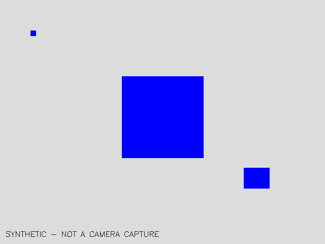
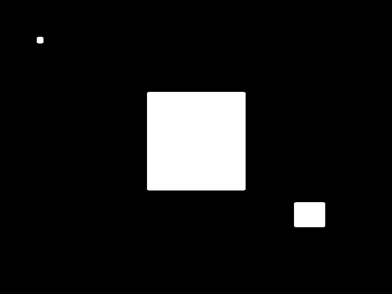
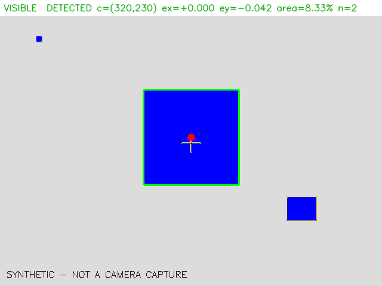
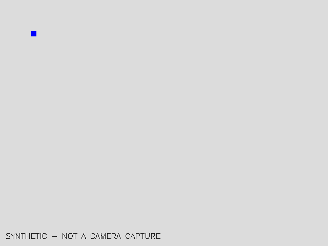
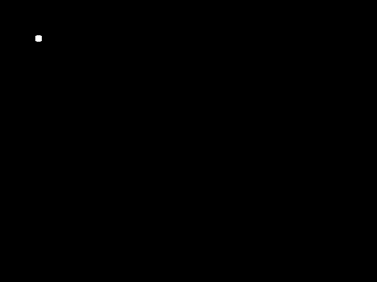
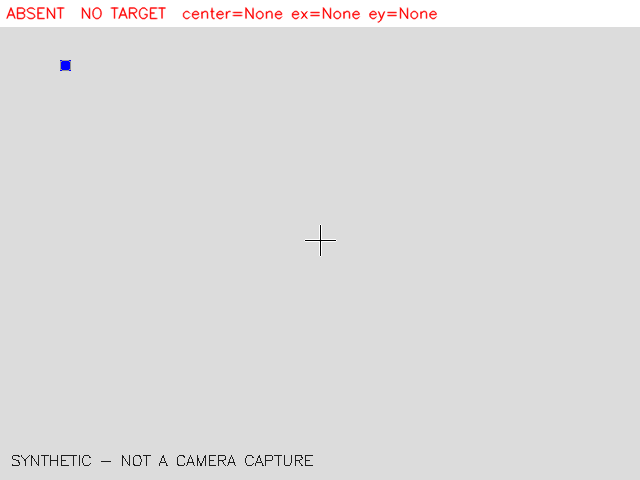
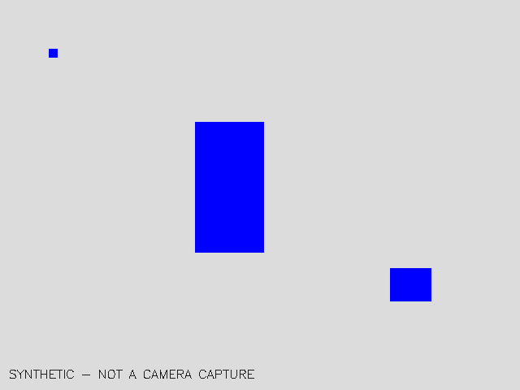
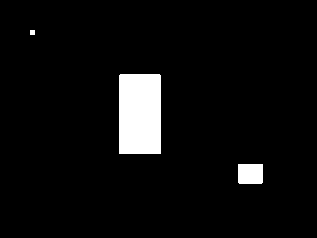

# 문제 1 — HSV·Contour 검출 파이프라인 보고서

> ⚠️ 장면 입력이 실제 카메라가 아니다: ['synthetic']. 제출 전 `python3 run.py scenes --camera`로 다시 기록한다.

## 1. 목표와 환경

- 목표: **blue_cube** (사진: `scene_0_visible_original.png`)
- 카메라: RealSense D435 컬러, backend=`realsense`, 실제 프레임 (640, 480), 처리 해상도 640×480
- 노출·화이트밸런스(기록 시점): 기록 없음 (config: exposure=None, white_balance=None; null=자동)

## 2. 파이프라인

영상 → 처리 해상도 리사이즈 → 가우시안 블러 → HSV 변환 → `inRange` 색상 마스크(범위 여러 개는 합집합) → 열림(점 잡음 제거)·닫힘(구멍 메우기) → 외곽 컨투어 → 후보 필터 → 대상 선택 → 모멘트 중심 → 실제 프레임 좌표 복원 → 정규화 오차·면적비

- 정규화 오차: `ex=(cx-W/2)/(W/2)`, `ey=(cy-H/2)/(H/2)` — W·H는 실제 프레임 크기, 오른쪽·아래가 양수
- 면적비: `contour_area/(W×H)`
- 선택 규칙: 필터 통과 후보 중 면적 최대, 면적 차이 10% 이내면 영상 중심에 가까운 것

## 3. 실제 설정 (세 장면 공통)

```yaml
# 문제 1 설정 파일 — 코드 수정 없이 이 파일만 바꿔서 튜닝한다.
# 세 장면(보임·없음·가림)은 반드시 같은 설정 파일로 확인한다.

target:
  name: blue_cube            # 사진·결과 JSON에 기록되는 목표 이름
  # OpenCV HSV 범위: H 0~179, S 0~255, V 0~255
  # 빨강처럼 H가 0/179 경계를 넘는 색은 범위를 두 개 적는다(합집합).
  hsv_ranges:
    - lower: [100, 150, 60]
      upper: [125, 255, 255]

camera:
  backend: realsense         # realsense(pyrealsense2) | v4l2(OpenCV VideoCapture, 예비용)
  device: 6                  # v4l2 장치 번호(backend: v4l2일 때만). 이 PC에서는 /dev/video6 = D435i 컬러
  fps: 30
  warmup_frames: 30          # 자동 노출·화이트밸런스 안정화용으로 버리는 프레임 수
  # HSV 값은 노출·화이트밸런스가 바뀌면 같이 변한다. 튜닝 후에는 고정을 권장한다.
  # null = 자동. tune 모드에서 현재 자동값이 출력되니 그 값을 적으면 된다.
  exposure: null             # RealSense 컬러 노출(1~10000, 단위 0.1ms 상당)
  white_balance: null        # RealSense 화이트밸런스(2800~6500 K)

processing:
  # 처리 해상도. 입력이 다르면 이 크기로 리사이즈한 뒤 처리한다.
  # 면적 기준(min_area)은 이 해상도 기준 픽셀 수다.
  width: 640
  height: 480
  blur_ksize: 5              # 가우시안 블러 커널(홀수, 0이면 생략)
  morph_kernel: 5            # 모폴로지 커널 크기
  open_iterations: 1         # 열림: 작은 점 잡음 제거
  close_iterations: 2        # 닫힘: 물체 내부 구멍·틈 메우기

selection:
  min_area: 800              # 이 면적(px) 미만의 컨투어는 잡음으로 버린다
  max_area_ratio: 0.6        # 화면 면적 대비 이 비율 초과는 배경 오검출로 버린다
  min_solidity: 0.5          # 면적/볼록껍질 면적. 가림을 허용하려고 낮게 둔다
  # 후보 여러 개 중 선택 규칙:
  #   1) 위 필터를 통과한 후보 중 면적이 가장 큰 것
  #   2) 면적 차이가 tie_ratio 이내이면 영상 중심에 더 가까운 것
  tie_ratio: 0.1
```

## 4. 세 장면 결과 (같은 설정)

| 장면 | 판정 | detected | 중심(실제 px) | ex | ey | 면적비 | 통과 후보 | 탈락 사유 | 처리 ms |
|---|---|---|---|---|---|---|---|---|---|
| visible | **TP** | True | (320.0, 230.0) | 0.000 | -0.042 | 0.0833 | 2 | too_small×1 | 4.35 |
| absent | **TN** | False | None | None | None | None | 0 | too_small×1 | 1.92 |
| occluded | **TP** | True | (282.0, 230.0) | -0.119 | -0.042 | 0.0437 | 2 | too_small×1 | 1.56 |

TP=정검출, TN=정상 비검출, FN=미검출, FP=오검출. 세 장은 기능 확인용이며 일반 정확도를 입증하지 않는다.

### visible — TP

| 원본 | 마스크 | 검출 |
|---|---|---|
|  |  |  |

### absent — TN

| 원본 | 마스크 | 검출 |
|---|---|---|
|  |  |  |

### occluded — TP

| 원본 | 마스크 | 검출 |
|---|---|---|
|  |  |  |

검출 이미지 표시: 초록 컨투어=선택 목표, 노랑=통과 후보, 회색=탈락, 빨간 점=목표 중심, 흰 십자=영상 중심.

검출·미검출 기록: `scenes.json`, 장면별 `scene_N_*.json`

## 5. HSV 범위를 정한 근거

최종 범위: H100~125, S150~255, V60~255

> `tune`에서 목표를 드래그한 뒤 **w**를 누르면 `tune/hsv_basis.json`이 생겨 이 절이 채워진다.

- 색공간 선택: HSV의 H·S는 밝기 배율이 바뀌어도 값이 변하지 않는다(같은 색 ×0.6/×1.0/×1.4 → H·S 동일). Lab의 a·b, YCrCb의 Cr·Cb는 밝기에 따라 값이 이동해 큐브의 밝은 면·그늘진 면이 다른 범위로 간다.

| 색공간 | 검증 목표 검출률 | 배경 오검출률 | 분리도 AUC |
|---|---|---|---|
| HSV | 0.99 | 0.59 | 0.69 |
| Lab | 1.00 | 0.81 | 0.32 |
| YCrCb | 1.00 | 0.80 | 0.37 |

(`compare_colorspaces.py`, 영상 `shirt_stripes.png`)

## 6. 배경 오검출을 줄인 조건

| 조건 | 값 | 역할 |
|---|---|---|
| S 하한 | 150 | 흰 벽·회색·채도 낮은 옷처럼 색이 옅은 배경 제거 |
| V 하한 | 60 | 어두운 그림자·검은 물체(H가 불안정) 제거 |
| H 폭 | 100~125 | 다른 색 계열 제거 |
| 블러 | 5 | 센서 잡음으로 생기는 점 마스크 감소 |
| 열림/닫힘 | 커널 5, 1회/2회 | 작은 점 제거 / 목표 내부 구멍 메움 |
| 최소 면적 | 800 px | 작은 같은 색 조각 탈락(`too_small`) |
| 최대 면적비 | 0.6 | 화면 대부분이 걸리면 배경으로 간주(`too_large`) |
| 최소 solidity | 0.5 | 가늘고 구불구불한 배경 조각 탈락(`low_solidity`), 가림 허용 위해 낮게 |

세 장면에서 필터가 걸러낸 컨투어: {'too_small': 3}

## 7. 미검출 전달 방식

- `detect()`는 상태를 갖지 않는다. 매 프레임 독립 판단하므로 이전 프레임 좌표가 섞일 경로가 없다.
- 미검출이면 `detected=false`이고 `center`, `center_original`, `error(ex,ey)`, `area_ratio`, `bbox`가 모두 **`null`**이다. 0이나 직전 값으로 채우지 않는다 — `ex=0`은 "정중앙"이라는 유효한 값이므로 미검출과 구분되어야 한다.
- 받는 쪽은 `detected`를 먼저 확인하고, false면 목표 추종을 멈춘다(이전 좌표를 새 목표로 쓰지 않는다).
- 화면에는 `NO TARGET center=None ex=None ey=None`을 표시하고 목표 중심 표시는 그리지 않는다.

```json
{
  "scene": "absent",
  "verdict": "TN",
  "detected": false,
  "center_original": null,
  "error": null,
  "area_ratio": null,
  "bbox": null,
  "rejected": [
    "too_small"
  ]
}
```

## 8. 심화 — 조건 변화에 따른 검출률·처리 속도

같은 설정으로 목표가 보이는 상태에서 프레임마다 검출. 기준=`baseline`.

| 조건 | 입력 | 노출/WB | 프레임 | 검출률 | Δ검출률 | 평균 면적비 | ex 평균±표준편차 | 처리 ms (평균/p95) | 처리 fps | 캡처 ms |
|---|---|---|---|---|---|---|---|---|---|---|
| baseline | synthetic | - | 200 | 100.0% | +0.0% | 0.0833 | +0.000±0.000 | 1.00/1.29 | 996 | None |
| dim_sim | synthetic ×0.2 | - | 200 | 0.0% | -100.0% | None | - | 0.96/1.24 | 1043 | None |

×gain은 영상 밝기를 곱한 **모의** 조건이며 실제 조명 변화(감마·노이즈·포화)와 같지 않다.

처리 ms는 리사이즈~중심 계산 시간(표시·저장 제외), 캡처 ms는 프레임 대기 시간(30 fps면 약 33 ms)이다.
