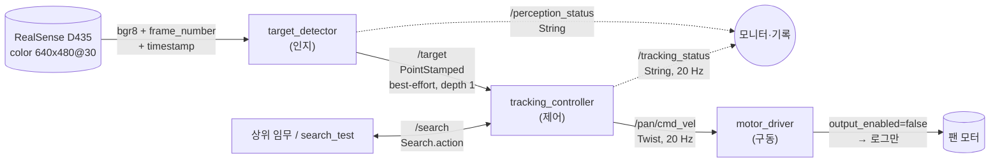
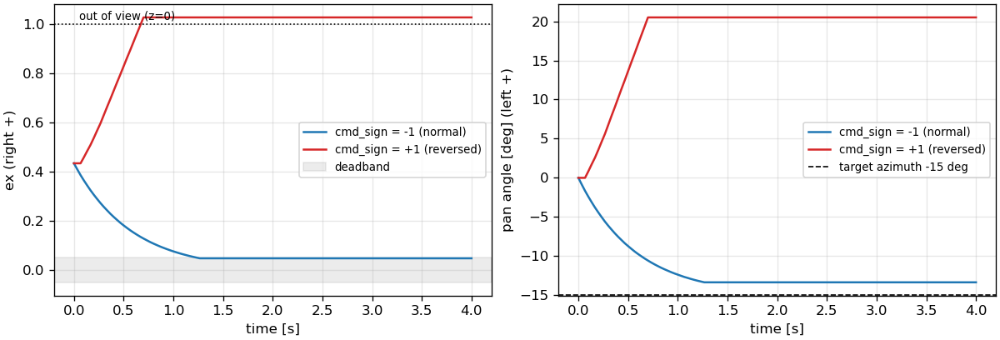

# 문제 2 — 인지·제어 노드 연결 보고서

ROS 2 Lyrical, Python(rclpy). 패키지 `target_tracking`(노드), `tracking_interfaces`(/search 액션). **모든 시험은 모터 출력 OFF**(`motor_driver.output_enabled=false`)로 수행했다.

## 1. 노드·연결 구조

| 노드 | 책임 | 하지 않는 것 |
|---|---|---|
| target_detector | 영상 획득, **새 영상인지 확인**(frame_number 증가), 시각 결정(촬영/수신), 문제 1 검출, ex·ey·면적비 계산, 미검출 시 z=0 발행, 카메라 정지 감지(CAMERA_STALL) | 명령 계산, 이전 좌표 유지, 정지 영상 재발행 |
| tracking_controller | 입력 **신선도** 판정(stamp 증가·나이·값 범위), 상태 결정, 명령 계산(부호·게인·데드밴드·포화), 20 Hz 고정 주기 발행, 타임아웃 정지, /search 실행 | 영상 처리, 하드웨어 접근 |
| motor_driver | `/pan/cmd_vel`의 **유일한** 하드웨어 출력 지점, 출력 허용(output_enabled), 명령 끊김 감시(0.2 s), 하드웨어 한계 | 목표 판단, 상태 판단 |
| interface_check / input_test / pan_sim / search_test | 시험 도구(입력 주입·기록·검사·폐루프 모의) | 실제 시스템 구성 아님 |

## 2. 인터페이스 표 (구현 값)

표의 토픽·타입·QoS는 `target_tracking/interface.py`, 수치는 `config/tracking.yaml`에서 생성했다. 노드도 같은 파일을 import하므로 표와 구현이 갈라지지 않는다.

| 항목 | 규약 |
|---|---|
| 목표 토픽 | `/target` · `geometry_msgs/msg/PointStamped` · 발행 target_detector → 구독 tracking_controller |
| header.stamp | 원본 영상 촬영 시각(RealSense global/system time 도메인). 도메인이 다르면 영상 수신 시각 — /perception_status와 로그에 명시 |
| header.frame_id | camera_color |
| point.x | ex = (cx-W/2)/(W/2), 오른쪽 + [-1, 1] |
| point.y | ey = (cy-H/2)/(H/2), 아래쪽 + [-1, 1] |
| point.z | 면적비 contour_area/(W×H) (0, 1]. 0 = 미검출(x·y 무시) |
| 발행 | 영상 처리마다 1회(카메라 30 fps). 정상 영상의 미검출도 z=0으로 발행. 새 영상이 없으면 발행하지 않는다(이전 영상 재발행 금지) |
| QoS | /target: **best-effort, keep_last depth 1** (발행·구독 동일). 상태·명령: reliable, keep_last depth 1 |
| 상태 | `/tracking_status` · `std_msgs/msg/String` · 명령과 같은 20 Hz · 값: `WAITING`, `TRACKING`, `CENTERED`, `LOST`, `TIMEOUT`, `SEARCHING` (아래 표) |
| 모터 명령 | **속도 방식** `/pan/cmd_vel` · `geometry_msgs/msg/Twist` · angular.z [rad/s], REP-103 왼쪽(반시계) + · 명령 = cmd_sign(-1) × kp(1.0) × ex, |ex|<0.05 → 0, 포화 ±0.6 rad/s · 주기 20 Hz · **정지 명령 = angular.z 0.0을 같은 주기로 계속 발행** · 구동부 감시 0.2 s |
| 타임아웃 | 마지막 **신선한** 입력 수신 후 **0.5 s** (과제 기본값 유지 — 30 fps에서 약 15프레임 연속 유실, 검출 1~2프레임 누락에 정지하지 않을 만큼 길고 사람이 알아챌 만큼 길지 않다). 신선함 = header.stamp가 직전보다 크고 나이 ≤ 0.5 s, 값이 범위 안 |
| 인지 상태 | `/perception_status` · OK | NO_TARGET | CAMERA_STALL | CAMERA_ERROR ; stamp=<capture|receive> · 상태가 바뀔 때 + 1 Hz |
| 탐색 액션 | `/search` · `tracking_interfaces/action/Search` · 서버 tracking_controller · 요청(direction ±1, speed rad/s, timeout s) → 진행(elapsed, angular_z, state) → 결과(found, reason: FOUND/TIMEOUT/CANCELED/NO_INPUT) |
| 카메라 정지 | 새 영상 없음 0.3 s → CAMERA_STALL, /target 발행 중단 |

PointStamped는 이 과제의 목표 정보 전달 규약이며 3차원 위치가 아니다.

| 상태 값 | 의미 → 명령 |
|---|---|
| `WAITING` | 시작 후 신선한 입력을 아직 받지 못함 → 정지 |
| `TRACKING` | 검출(z>0), |ex| ≥ deadband → 오차를 줄이는 회전 |
| `CENTERED` | 검출(z>0), |ex| < deadband → 정지(중심에서 불필요한 회전 없음) |
| `LOST` | 신선한 입력의 z=0(미검출) → 정지, 이전 좌표 사용 안 함 |
| `TIMEOUT` | 마지막 신선한 입력 수신 후 timeout 초과(토픽 침묵·카메라 정지) → 정지 |
| `SEARCHING` | /search 액션 실행 중 → 지정 방향 일정 속도 회전 |

### 구현 일치 검사 (`interface_check`, 실행 중인 그래프 조회)

| 토픽 | 타입 | 발행 노드 / QoS | 구독 노드 / QoS | 실측 주기 | 일치 |
|---|---|---|---|---|---|
| `/target` | geometry_msgs/msg/PointStamped | target_detector / best_effort/keep_last/depth=1 | tracking_controller / best_effort/keep_last/depth=1 | 30.0 Hz (최대 간격 0.035 s) | ✅ |
| `/perception_status` | std_msgs/msg/String | target_detector / reliable/keep_last/depth=1 | - | 1.33 Hz (최대 간격 1.0 s) | ✅ |
| `/pan/cmd_vel` | geometry_msgs/msg/Twist | tracking_controller / reliable/keep_last/depth=1 | motor_driver / reliable/keep_last/depth=1 | 20.0 Hz (최대 간격 0.051 s) | ✅ |
| `/tracking_status` | std_msgs/msg/String | tracking_controller / reliable/keep_last/depth=1 | - | 20.0 Hz (최대 간격 0.051 s) | ✅ |

구독 측 호환: reliable 구독자로 best-effort `/target`을 구독하면 **수신 0건**, incompatible QoS 이벤트 `RMW_QOS_POLICY_RELIABILITY`. → /target 구독자는 반드시 best-effort로 맞춘다(best-effort 구독자는 reliable 발행자와도 호환). `ros2 topic echo`는 발행자 QoS에 자동으로 맞춘다.

## 3. 다섯 입력 확인 (모터 출력 OFF)

`ros2 launch target_tracking test_inputs.launch.py` — input_test가 30 Hz로 입력을 넣고, 컨트롤러의 20 Hz 명령·상태를 같은 tick으로 짝지어 기록했다. 정상 상태 = 각 구간 0.7 s 이후.

| # | 입력 | 기대 결과 | 정상 상태 | angular.z [rad/s] | 기대 상태 도달 | 판정 |
|---|---|---|---|---|---|---|
| 1 | x=+0.0, z=0.05 | 중심에서 불필요한 회전 없음 | CENTERED | +0.000 | 0.028 s | PASS |
| 2 | x=+0.4, z=0.05 | 오른쪽 오차를 줄이는 명령 | TRACKING | -0.400 | 0.045 s | PASS |
| 3 | x=-0.4, z=0.05 | 반대 방향 명령 | TRACKING | +0.400 | 0.045 s | PASS |
| 4 | x=+0.4, z=0.0 | 이전 목표를 쫓지 않고 정지 | LOST | +0.000 | 0.012 s | PASS |
| 5 | 발행 중단 | 타임아웃 감지 후 정지 | TIMEOUT | +0.000 | 0.512 s | PASS |
| 6 | x=+0.4, z=0.05, stamp=frozen | (추가) 같은 영상 재발행은 신선하지 않음 → 정지 | TIMEOUT | +0.000 | 0.512 s | PASS |
| 7 | x=+0.4, z=0.05, stamp=old | (추가) 오래된 촬영 시각 → 정지 | TIMEOUT | +0.000 | 0.012 s | PASS |
| 8 | x=+0.4, z=0.05 | (추가) 정상 입력 복귀 → 추종 재개 | TRACKING | -0.400 | 0.012 s | PASS |

- x=+0.4 → angular.z = −1 × 1.0 × 0.4 = **−0.4 rad/s**(오른쪽으로 회전, 오른쪽 오차 감소), x=−0.4 → **+0.4**.
- `lost`는 일부러 x=+0.4를 남긴 채 z=0을 보냈다 → 명령 0. z=0이면 x·y를 보지 않는다.
- `frozen`의 첫 장은 새 영상이라 잠깐 추종(−0.4)하고, 이후 같은 stamp 재발행은 거부되어 첫 장 0.5 s 뒤 TIMEOUT으로 정지한다. 메시지는 계속 오지만 타임아웃이 연장되지 않는다.
- `silence` 타임아웃 감지: 마지막 입력 후 0.512 s (= 0.5 s + tick 1개 이내).

### 명령·상태 로그 (상태 전이 시점)

| 구간 | 구간 내 시각 [s] | 상태 | angular.z |
|---|---|---|---|
| center | 0.028 | CENTERED | +0.000 |
| right | 0.045 | TRACKING | -0.400 |
| left | 0.045 | TRACKING | +0.400 |
| lost | 0.012 | LOST | +0.000 |
| silence | 0.012 | LOST | +0.000 |
| silence | 0.512 | TIMEOUT | +0.000 |
| frozen | 0.012 | TRACKING | -0.400 |
| frozen | 0.512 | TIMEOUT | +0.000 |
| old_stamp | 0.012 | TIMEOUT | +0.000 |
| recover | 0.012 | TRACKING | -0.400 |

전체 20 Hz 로그: `inputs_log.csv`, 요약: `inputs_summary.json`

### 전체 연결(인지→제어→구동) 확인 — 합성 영상 시나리오

target_detector(합성: 가림 2 s → 보임 1.5 s → 없음 1.5 s → **카메라 정지** 2.5 s) → controller → motor_driver(OFF).

| t [s] | /target (x, z) | /perception_status | /tracking_status | angular.z |
|---|---|---|---|---|
| 0.10 | (None, None) | None | WAITING | 0.0 |
| 0.15 | (-0.1187, 0.0437) | OK; stamp=receive(synthetic) | TRACKING | 0.1187 |
| 2.15 | (0.0, 0.0833) | OK; stamp=receive(synthetic) | CENTERED | 0.0 |
| 3.65 | (0.0, 0.0) | NO_TARGET; stamp=receive(synthetic) | LOST | 0.0 |
| 5.45 | (0.0, 0.0) | CAMERA_STALL; stamp=receive(synthetic) | LOST | 0.0 |
| 5.60 | (0.0, 0.0) | CAMERA_STALL; stamp=receive(synthetic) | TIMEOUT | 0.0 |

가림 장면(ex=−0.119, 목표가 왼쪽) → +0.119 rad/s(왼쪽 회전). 카메라 정지 시 detector는 발행을 멈추고(CAMERA_STALL), 컨트롤러는 마지막 신선한 입력 0.5 s 후 TIMEOUT으로 정지했다.

## 4. 부호가 반대일 때의 현상

`pan_sim`(팬 각도 적분 + 화각 69° 카메라 모의, 목표 방위각 −15° = 오른쪽)으로 폐루프를 돌렸다.

| cmd_sign | 시작 ex | 끝 ex | 최대 |ex| | 끝 팬 각도 | 중심 도달 | 시야 이탈 |
|---|---|---|---|---|---|---|
| −1 (정상) | +0.435 | +0.048 | 0.435 | -13.3° | 1.267 s | - s |
| +1 (반대) | +0.435 | +1.029 | 1.029 | +20.5° | - s | 0.7 s |

부호가 반대면 오차를 줄이는 대신 키우는 **양의 되먹임**이 된다. 목표가 오른쪽(ex>0)인데 왼쪽으로 돌아 ex가 더 커지고, 명령은 포화(±0.6 rad/s)까지 커져 목표가 화각 밖으로 나간다(z=0 → LOST → 정지). 게인을 줄여도 발산 속도만 느려질 뿐 방향은 그대로다. 그래서 첫 시험(x=+0.4 → angular.z<0)을 **모터 출력 OFF**로 먼저 확인한다. 실제 모터는 드라이버·기구에 따라 +방향이 다를 수 있으므로 motor_driver에서 1회 확인하고, 부호 보정은 한 곳(cmd_sign 또는 드라이버)에서만 한다.

## 5. 미검출과 토픽 침묵의 차이

| | 미검출 (z=0) | 토픽 침묵 / 통신 중단 |
|---|---|---|
| 뜻 | 카메라·인지는 정상, **새 영상**에 목표가 없다 | 새 영상이 오지 않거나(카메라 정지·USB 끊김), 노드·네트워크가 멈췄다 |
| 신호 | 신선한 /target이 계속 옴(30 Hz), z=0 | /target이 안 옴, 또는 같은/오래된 stamp만 옴 |
| 판정 위치 | 메시지 내용(z) — 즉시 | 마지막 신선한 입력 이후 경과 — timeout(0.5 s) 후 |
| 상태 | `LOST` | `TIMEOUT` (+ 인지 쪽 `CAMERA_STALL`) |
| 명령 | 즉시 0 | timeout 후 0 (구동부도 0.2 s 명령 끊김 시 0) |
| 다음 행동 | /search 로 탐색 가능 — 영상은 들어오므로 찾으면 알 수 있다 | 탐색해도 찾았는지 알 수 없다 → /search는 NO_INPUT 실패 |

구분하지 않으면: 침묵을 미검출처럼 다루면 카메라가 죽은 채 탐색 회전을 계속하고, 미검출을 침묵처럼 다루면 0.5 s 동안 이전 명령으로 계속 돈다. **카메라가 멈췄는데 이전 영상에 새 시각을 붙여 보내면** 컨트롤러는 신선한 입력으로 믿고 이전 목표를 계속 쫓는다 — 그래서 detector는 frame_number가 증가한 새 영상만 처리·발행하고, 영상이 없으면 발행하지 않는다. 컨트롤러도 같은/이전 stamp(frozen)와 오래된 stamp(old_stamp)를 거부해 이중으로 막는다(3절 추가 시험).

## 6. header.stamp

- RealSense 프레임의 timestamp domain이 `global_time`/`system_time`이면 그 값(호스트 시계 기준 촬영 시각 추정)을 그대로 header.stamp로 쓴다. 호스트 시계와 −0.05~1 s 범위를 벗어나거나 다른 도메인이면 **영상 수신 시각**을 쓰고, `/perception_status`의 `stamp=receive(...)`와 로그로 명시한다.
- 합성 영상은 생성 시각 = 수신 시각(`stamp=receive(synthetic)`).
- 문제 1의 처리 시간(약 2.5 ms)은 stamp에 더하지 않는다 — stamp는 처리 완료가 아니라 영상 시각이다.

## 7. 심화 — /search 액션

`ros2 launch target_tracking search_test.launch.py`

| 경우 | 요청 | 결과 상태 | reason | 경과 [s] | 진행 피드백 수 | 탐색 중 /tracking_status | 판정 |
|---|---|---|---|---|---|---|---|
| found | dir +1, 0.3 rad/s, 3.0 s | succeeded | FOUND | 1.05 | 20 | LOST, SEARCHING | PASS |
| timeout | dir -1, 0.3 rad/s, 1.0 s | aborted | TIMEOUT | 1.03 | 20 | LOST, SEARCHING | PASS |
| cancel | dir +1, 0.3 rad/s, 5.0 s | canceled | CANCELED | 0.84 | 16 | LOST, SEARCHING | PASS |
| no_input | dir +1, 0.3 rad/s, 5.0 s | aborted | NO_INPUT | 0.54 | 10 | LOST, SEARCHING | PASS |
| invalid | dir +1, 0.0 rad/s, 1.0 s | rejected | - | - | - | - | PASS |

- 진행 피드백은 20 Hz tick마다 1회(elapsed, angular_z, state=SEARCHING).
- 탐색 회전도 같은 `/pan/cmd_vel`로 나간다 — 모터 명령을 내는 노드는 컨트롤러 하나뿐이다(명령 충돌 방지).
- 종료(성공·실패·취소) 즉시 `search` 상태를 지워 다음 tick부터 정상 상태 결정(정지 또는 추종)으로 돌아간다.

## 8. 구현 중 발견한 문제

- 다중 스레드 실행기(MultiThreadedExecutor)에서 30 Hz /target을 받는 동안 20 Hz 명령 타이머가 최대 0.3 s 밀렸다(실측 12~15 Hz). 단일 스레드 실행기로 바꾸고 /search를 블로킹 루프 대신 tick 기반으로 바꿔 20.0 Hz(최대 간격 0.051 s)를 확보했다.
- 명령과 상태를 따로 기록하면 상태가 한 tick 늦게 짝지어진다 → 컨트롤러가 같은 tick에 명령→상태 순으로 내는 점을 이용해 상태 수신 시 기록한다.
